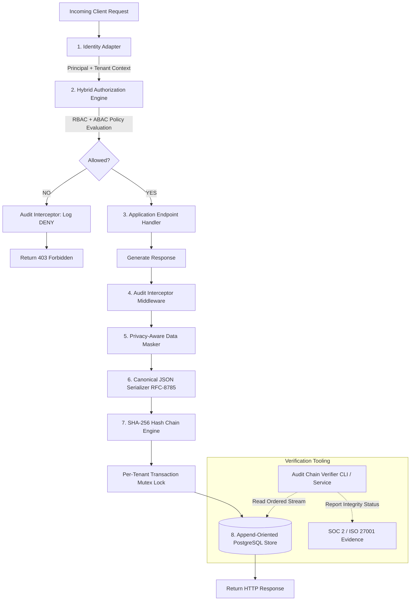

# Architecture Overview

The **Role-Based Identity & Audit Log Middleware Engine** is an enterprise-grade security middleware engine combining granular multi-tenant RBAC/ABAC authorization, SHA-256 tamper-evident hash chaining, and privacy-aware data masking.

## Layer Responsibilities

| Layer | Responsibility |
|---|---|
| **Identity Context** | Normalizes authenticated caller (`human`, `service`, `system`), tenant boundaries, roles, and security claims. |
| **Authorization Engine** | Evaluates RBAC role hierarchies (with cycle prevention and explicit deny) alongside fine-grained ABAC attribute conditions. |
| **Audit Interceptor** | Captures request context (correlation ID, client IP, route, timestamp, decision outcome). |
| **Data Masking** | Scrubs sensitive PII, passwords, authentication tokens, API keys, cookies, and credit cards before persistence. |
| **Audit Chain Engine** | Canonicalizes event fields and cryptographically links records via SHA-256 hash chains. |
| **Storage Adapter** | Provides append-oriented persistence in PostgreSQL (or in-memory mock) with row-level tenant indexing and advisory locking. |
| **Verification Tooling** | Validates 100% chain integrity, detects tampered records, and pinpoints broken links. |

## Request Lifecycle (PRD Section 8)

1. **Request Ingestion**: Request enters Express or NestJS middleware.
2. **Identity Resolution**: `identityMiddleware` resolves `principal` (id, type, roles, attributes) and `tenant` (tenantId, status).
3. **Resource & Action Resolution**: Identifies requested domain operation (e.g. `invoice:read`, `patient:update`).
4. **Policy Evaluation**: `AuthorizationEngine` loads applicable tenant policies and evaluates RBAC roles + ABAC conditions.
5. **Decision Synthesis**: Produces `ALLOW` or `DENY` with full explanation trace.
6. **Access Enforcement**: If denied, logs denial event and returns 403 Forbidden.
7. **Execution**: If allowed, application proceeds.
8. **Sensitive Field Masking**: Request/response payloads pass through `DataMasker`.
9. **Hash Chaining**: `AuditChainEngine` fetches previous chain head hash and computes:
   $$\text{event\_hash} = \text{SHA256}(\text{canonical\_json}(\text{event}) \parallel \text{"\|"} \parallel \text{previous\_hash})$$
10. **Storage**: Event is written to PostgreSQL inside a serialized transaction.
